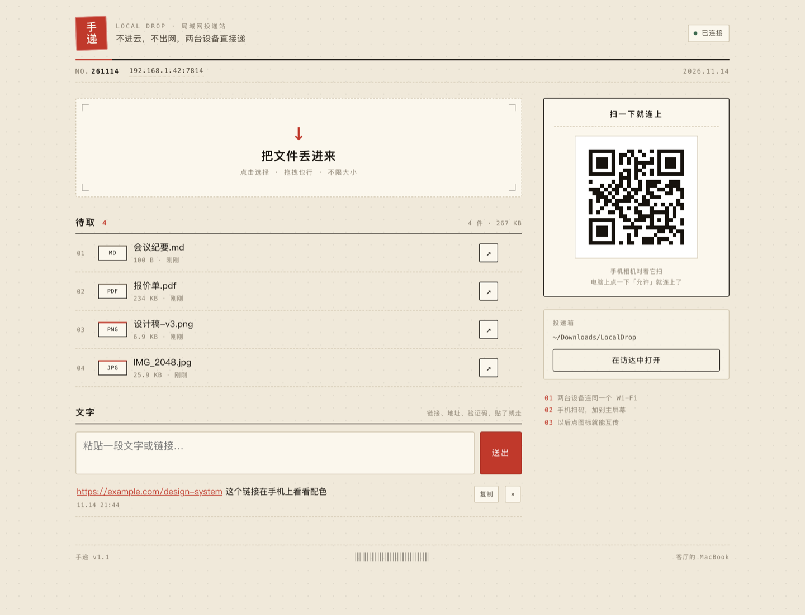

# Shoudi · LocalDrop

**Send files between your computer and your phone over your local Wi-Fi.**
Nothing to install on the phone, no cloud, no compression, no size limit.

[中文 →](README.md) · [Download](#download) · [Security](#security-strangers-cant-get-in) · [Build](#build-from-source)



## Why another file-transfer tool

WeChat compresses photos and caps file size. QQ wants a login. Bluetooth is painfully slow.
AirDrop only talks to Apple devices. Moving a photo from your phone to your laptop should be one tap.

The trade-off here: **a tiny server runs on your computer, and the phone installs nothing.**
Scan a QR code, get the transfer page, add it to your home screen — that's it.

## Features

- **Zero install on mobile** — it's just a web page: no permissions, no updates
- **Both directions** — phone → computer, computer → phone, plus a shared text clipboard
- **No compression, no size limit** — direct over the LAN, videos and photos untouched
- **Drag & drop** — drop files onto the Mac Dock icon or the Windows desktop shortcut
- **Realtime** — both sides update instantly via SSE
- **Device pairing** — strangers can't get in; revoke any device anytime
- **Zero dependencies** — server and frontend use only the Node standard library; the apps bundle the runtime
- Dark mode, home-screen icon, range requests

## Download

| Platform | File | Notes |
| --- | --- | --- |
| macOS 13.5+ (Apple Silicon) | [shoudi-macos-arm64.zip](https://github.com/Aarontaken/shoudi/releases/latest/download/shoudi-macos-arm64.zip) | 37MB, Node runtime included |
| Windows 10/11 x64 | [shoudi-windows-x64.zip](https://github.com/Aarontaken/shoudi/releases/latest/download/shoudi-windows-x64.zip) | 33MB, node.exe included |

> No code-signing certificate yet: on macOS, right-click → Open the first time; on Windows you may need “More info → Run anyway”. It's a one-time thing.

### macOS

1. Unzip, drag `手递.app` into Applications or the Dock
2. Click it — your browser opens the transfer page; the icon stays in the Dock
3. Scan the QR code with your phone → click “Allow” on the computer

You can also drop files straight onto the Dock icon.

### Windows

1. Unzip `shoudi-win` somewhere permanent (e.g. `D:\Tools\shoudi`)
2. Double-click `start.vbs` — the browser opens the transfer page (no console window)
3. Double-click `install-shortcut.vbs` to put a “手递” icon on your desktop

Windows will ask about the firewall on first run — **allow it and tick “Private networks”**, or the phone won't be able to connect.

### Phone

Scan the QR code → the browser opens the page → click “Allow” on the computer → “Add to Home Screen”.
From then on it's just an icon on your phone. **No app to install.**

## How to transfer

| Task | How |
| --- | --- |
| Phone → computer | Tap “把文件丢进来”, pick files; they land in `~/Downloads/LocalDrop` |
| Computer → phone | Drop files onto the page, or onto the Dock/desktop icon; tap `↓` on the phone |
| Text / links | Paste on either side, tap “复制” on the other |
| Screenshots | `Cmd+V` on the computer, straight into the page |

## Security: strangers can't get in

Knowing the address isn't enough. The first connection must be approved on the computer:

```
phone scans ──► waiting for approval ──► computer shows “iPhone wants to connect” ──► Allow
                                                  │
                                                  └─ device is remembered (180 days)
```

- The computer page lists authorized devices; revoking one takes effect immediately
- **Deleting files, revealing folders, stopping the server** are computer-only actions
- The QR code is just an address, not a key
- Pairings live in `~/Downloads/LocalDrop/.devices.json` (delete it to reset)

Traffic stays on your LAN — no cloud, no third-party server. Don't expose port 7788 to the internet.

## Build from source

Requires Node 18+. Building the Mac app requires macOS.

```bash
git clone https://github.com/Aarontaken/shoudi.git
cd shoudi

# run it directly (no dependencies to install)
node server.mjs --open

# build the Mac app + shareable zip
./scripts/build-app.command --share

# build the Windows package
./scripts/build-win.command
```

The build downloads a Node runtime once (52MB for macOS, 30MB for Windows) and caches it in `.cache/`.

## Project layout

```
server.mjs                 server: page + upload/download + pairing + SSE, zero deps
web/                       frontend (vanilla JS, no framework)
scripts/build-app.command  package the macOS app
scripts/build-win.command  package the Windows bundle
scripts/app.applescript    drag & drop entry point
scripts/bundle-launch.sh   launcher inside the app
docs/                      screenshots
```

## FAQ

**Phone can't connect after switching Wi-Fi?**
The QR code encodes the current LAN address — rescan it. DHCP usually keeps the same lease for a desktop.

**Port already in use?**
`node server.mjs --port 8080`, or set `SHOUDI_PORT`.

**Where do files go?**
`~/Downloads/LocalDrop` by default (`%USERPROFILE%\Downloads\LocalDrop` on Windows). Change it with `--dir`.

**Why no app on the phone?**
Installing an app is a recurring cost for every new device. A web page has no install, no permissions, no updates.
The price is knowing the address — solved with a QR code, saved once as a home-screen icon.

**How is this different from LocalSend?**
LocalSend is great, but every device has to install it. The trade-off here: one background process on the computer, zero cost on any phone.

**Customizing colors, name, port?**
CSS variables at the top of `web/style.css`; `SHOUDI_DEVICE="Studio Mac" node server.mjs`; `node server.mjs --help`.

## License

[MIT](LICENSE). `web/qrcode.js` is by Kazuhiko Arase (MIT).
