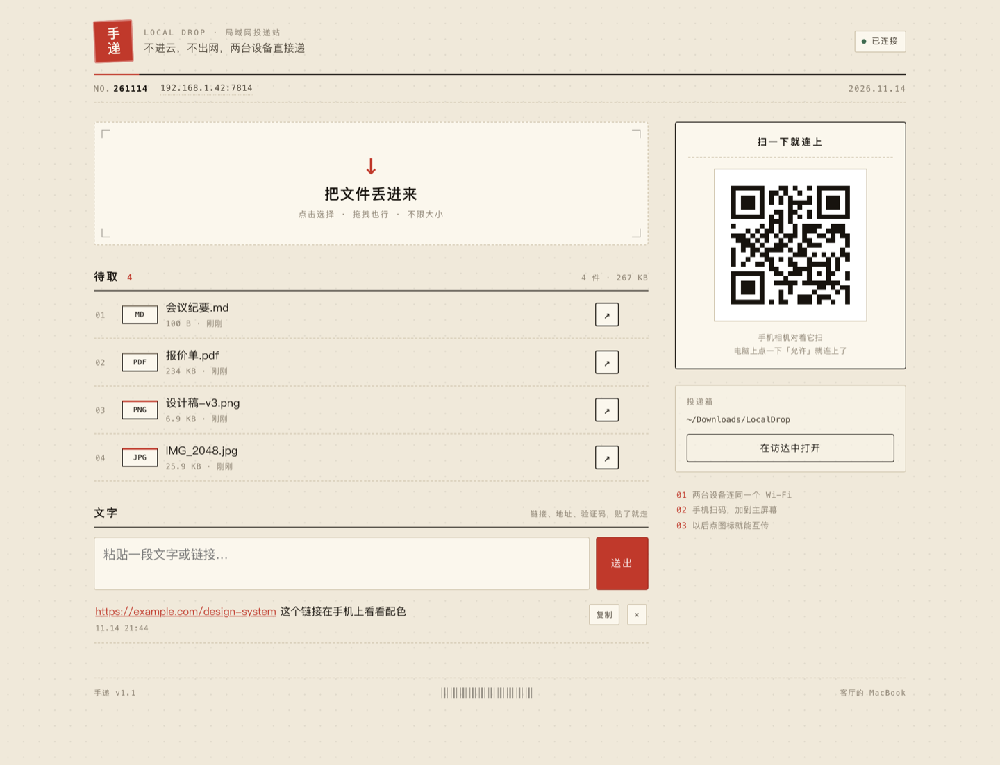

# 手递 · LocalDrop

**电脑 ⇄ 手机，同一个 Wi-Fi 下直接递文件。**
不用微信、不用 QQ、不用蓝牙、不用数据线。**手机不装任何 App**，浏览器打开就能传。



## 它是怎么个方便法

电脑上开着一个很小的服务，页面上有个二维码：

1. 手机相机扫一下 → 打开传输页
2. 浏览器菜单里「添加到主屏幕」→ 桌面上多一个图标
3. 以后点这个图标，就是传输页，跟 App 一样

然后：

| 想干什么 | 怎么做 |
| --- | --- |
| 手机 → 电脑 | 点「把文件丢进来」选文件，电脑上 `~/Downloads/LocalDrop` 里就能看到 |
| 电脑 → 手机 | 把文件拖进投递框、**或者直接拖到 `手递.app` 图标上**，手机上点 `↓` |
| 传一段文字/链接 | 任意一边贴进去，另一边点「复制」 |
| 传截图 | 电脑上 `Cmd+V` 直接粘进页面就发出去了 |

两台设备同时开着页面时，**哪边传的，另一边秒出现**，不用刷新。

## 开始用

### Mac

**`手递.app` 是自包含的** —— Node 运行时、服务端、页面全在里面，别人的电脑上什么都不用装。

把它拖到「程序坞」或「应用程序」，点一下：

- 服务没跑，它先把服务拉起来（第一次等一两秒）
- 然后在浏览器里打开页面
- **图标会一直留在程序坞里**，再点一下就是重新打开页面

**把文件直接拖到图标上** = 直接投递，手机上点 `↓` 就能拿，连页面都不用开。
想退出就在图标上点右键 →「退出」；退出只是关掉这个启动器，后台服务还在跑。

> 从聊天工具 / 网盘传过来的 app，第一次打开会被系统拦一下：**右键 →「打开」**。
> 页面没弹出来就是 <http://127.0.0.1:7788/>。

命令行也能用：`启动手递.command`（后台启动 + 开页面）。

### Windows

解压 **`手递-Windows.zip`**，把里面的 `shoudi-win` 文件夹放到一个固定位置（比如 `D:\Tools\shoudi`），然后：

1. 双击 `start.vbs` → 浏览器打开传输页（没有黑窗口）
2. 双击 `install-shortcut.vbs` → 桌面多一个「手递」图标，以后点它就行

同样可以把文件直接拖到桌面图标上投递。包里自带 `node.exe`，对方不用装 Node。

- 第一次运行会弹防火墙提示，**必须选「允许访问」并勾上「专用网络」**，不然手机连不上。
- 从网上下载的压缩包，第一次打开可能弹「Windows 已保护你的电脑」：更多信息 → 仍要运行。
- 文件夹别挪位置（桌面快捷方式用的是绝对路径），要挪就重新双击一次 `install-shortcut.vbs`。

### 分享给别人

| 给对方什么 | 体积 | 对方要做什么 |
| --- | --- | --- |
| `手递-macOS.zip` | 37MB | 解压 → 拖进「应用程序」→ 第一次右键「打开」 |
| `手递-Windows.zip` | 33MB | 解压 → 双击 `start.vbs`（或先建桌面图标）|

两边都**不需要装 Node**，不需要这个项目文件夹，文件也只存在他们自己的电脑和局域网里。

> 这两个 zip 是构建产物，不放进仓库。自己要用：
> `./scripts/build-app.command --share`（macOS）、`./scripts/build-win.command`（Windows）。
> 首次构建会从 nodejs.org 下载一次运行时（约 50MB / 30MB），之后走缓存。

Mac 这边的限制：

- 内置运行时是 **Apple 芯片（M 系列）** 版。Intel Mac 上如果装了 Node 会自动改用系统的，没装就跑不了。
- 系统要求 **macOS 13.5+**。
- 改了页面/服务端之后：`scripts/build-app.command --share` 重新生成 app + zip；Windows 用 `scripts/build-win.command`。

### 让它一直开着（推荐）

- **Mac**：双击 `scripts/开启开机自启.command` → 开机自动在后台跑，没有窗口。
  装完会直接帮你把页面打开；以后想打开就用 **`手递.app`** 那个图标。
  取消：`scripts/关闭开机自启.command`
- **Windows**：不用装自启，点桌面图标时才会启动服务（想开机就有，把桌面快捷方式复制到启动文件夹即可，只是开机时会顺带弹一次页面）。

装好自启之后，日常就只剩一步：**手机点图标，传。**

> 页面打不开的时候看这里：Mac 的日志在 `~/Library/Logs/shoudi.log`，Windows 在 `%TEMP%\shoudi-server.log`。

## 安全：陌生设备连不进来

同一个 Wi-Fi 下的其他设备，光知道地址是打不开的：

1. 手机第一次打开 → 页面停在「等待电脑确认」
2. 电脑上弹出「Mac · Chrome 192.168.3.5 想连接这台电脑」→ 点「允许」
3. 这台设备就被记住了（cookie，180 天），以后投递 / 查看 / 下载都不再打扰
4. 电脑页面右边有「已授权的设备」，可以随时撤销；**撤销立即生效**

另外：

- **删文件、打开文件夹、在电脑上打开、关闭服务** 只有电脑自己能做，手机上根本没有这些按钮
- 二维码只是地址，不代表放行；扫了也要在电脑上点一下
- 授权记录在 `~/Downloads/LocalDrop/.devices.json`，删掉它 = 清空所有授权
- 电脑页面没开着的时候，有人请求连接会自动把页面弹出来

## 一些说明

**文件存在哪？**
默认 `~/Downloads/LocalDrop`（Windows 是 `C:\Users\你\Downloads\LocalDrop`）。右边栏有「打开文件夹」按钮。
想换地方：`node server.mjs --dir ~/Desktop/互传`

**换 Wi-Fi / 换 IP 了怎么办？**
二维码里的地址是当前局域网 IP，换了网络重新扫一下就行。已经加到主屏幕的图标，如果 IP 变了要重新添加（路由器的 DHCP 一般会让同一台电脑保持同一个 IP，多数时候不用管）。

**端口被占用？**
`node server.mjs --port 8080`

**安全吗？**
数据只在你的局域网里走，不上云、不经过任何服务器。
陌生设备必须先在电脑上点「允许」才能连上；删除、打开文件夹这类动作只能在电脑上做。
详见上面的「安全」一节。别把这个端口映射到公网。

**为什么手机不用装 App？**
因为装 App 是个一次性的、但对每台新设备都要重复的成本。浏览器页面没有安装、没有权限、没有更新，扫码即用，谁都能用。代价是必须先知道地址 —— 所以用二维码解决，扫一次，存成图标。

**和 LocalSend / AirDroid 比呢？**
LocalSend 很好，但要三台设备都装。这个的取舍是：**电脑上多个后台进程，换手机零成本**。

## 文件结构

```
手递.app                   自包含的 Mac app（构建产物，含 Node 运行时）
手递-macOS.zip             分享给别人的 Mac 包（构建产物）
手递-Windows.zip           分享给别人的 Windows 包（构建产物）
server.mjs                 服务端：静态页 + 上传/下载 + SSE，零依赖
web/index.html             页面
web/style.css              样式（一套「快递运单」的纸感设计）
web/app.js                 前端逻辑
web/qrcode.js              二维码（MIT，Kazuhiko Arase）
启动手递.command           终端里手动启动（开发用）
启动手递.bat               Windows 命令行启动（开发用，需要装 Node）
scripts/build-app.command  重新生成 Mac app（--share 顺便打 zip）
scripts/build-win.command  重新生成 Windows 包
scripts/win/               Windows 包的原料（start.vbs / 快捷方式 / 说明）
scripts/app.applescript    app 里那段 AppleScript（拖放就靠它）
scripts/bundle-launch.sh   app 背后真正干活的脚本
scripts/                   开机自启的安装/卸载
```

`手递.app` 里的结构：

```
Contents/Resources/node             Node 运行时（Apple 芯片）
Contents/Resources/app/server.mjs   服务端
Contents/Resources/app/web/         页面
Contents/Resources/launch.sh        启动脚本
```

改完 `web/` 或 `server.mjs` 之后跑一次 `scripts/build-app.command` 就会同步进 app。
命令行版需要 Node 18+；app 版不需要。

## 改起来

- 配色、圆角、字号：`web/style.css` 顶部的 `:root` 变量
- 端口、目录、是否自动开浏览器：`node server.mjs --help`
- 想改页面上的电脑名字：`SHOUDI_DEVICE="书房的 Mac" node server.mjs`
- 多网卡时二维码地址选错：`SHOUDI_IP=192.168.1.42 node server.mjs`
- 配对逻辑：`server.mjs` 里的 `identify()` / `/api/pair`，设备记录存在 `.devices.json`

---

手递 v1.1 · 自己用的小工具
